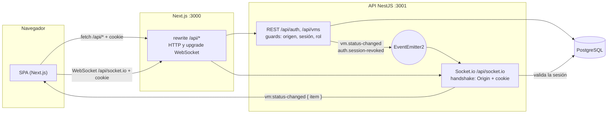
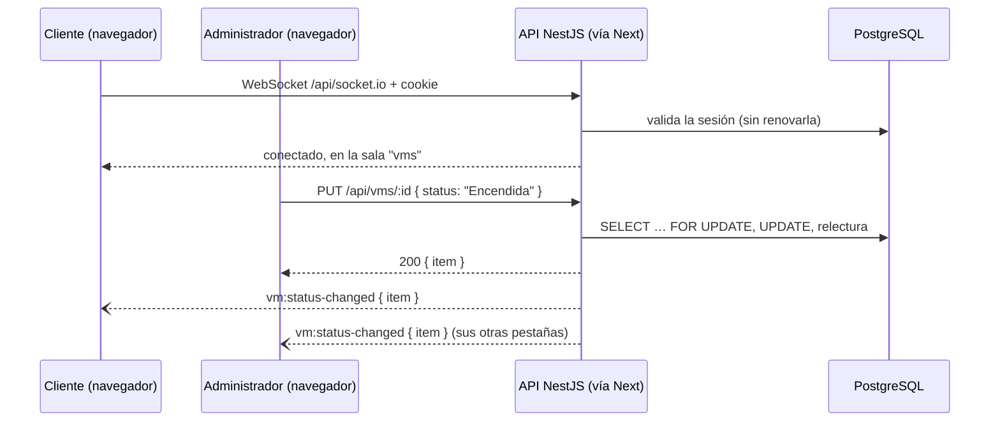

# Gestor de Máquinas Virtuales

Single Page Application para gestionar máquinas virtuales (VMs), con una API REST de soporte.

## Qué hace

- **Acceso seguro:** login con email y contraseña; la sesión es un JWT en una cookie `HttpOnly`,
  `Secure` y `SameSite`, nunca en `localStorage`.
- **Roles:** el **Administrador** crea, edita y elimina VMs; el **Cliente** solo las consulta (la UI
  le oculta las acciones de escritura y la API las rechaza).
- **VMs:** listado, creación y edición con validación en tiempo real (`name`, `cores`, `ram`,
  `disk`, `os`, `status`), con _optimistic UI_ que revierte el cambio si la API falla.
- **Dashboard:** gráficos con la suma de cores, RAM y disco de las VMs activas.
- **Tiempo real:** cuando un Administrador cambia el estado de una VM, todos los clientes
  conectados lo ven al instante.
- **UX:** dark mode, skeletons de carga, toasts y estados vacíos.

Visión completa, alcance y decisiones abiertas: [`docs/product.md`](docs/product.md).

> **Estado:** está implementado el backend de tres capacidades: `auth` (login, sesión en cookie
> `HttpOnly`, roles y endurecimiento OWASP), `virtual-machines` (CRUD en `/api/vms`) y
> `realtime-vm-status` (Socket.io en `/api/socket.io`: difusión de los cambios de estado). Specs en
> `docs/specs/`. El resto se agrega con el flujo SDD (`docs/sdd/README.md`).

| Paquete             | Ruta                     | Stack                                                     |
| ------------------- | ------------------------ | --------------------------------------------------------- |
| `@vm/backend`       | `apps/backend`           | Nest.js 11, TypeORM + PostgreSQL, Zod, JWT en cookie      |
| `@vm/frontend`      | `apps/frontend`          | Next.js 16 (App Router), Tailwind CSS 4, TanStack Table 8 |
| `@vm/shared-types`  | `packages/shared-types`  | Contratos compartidos (CJS + ESM vía tsup)                |
| `@vm/tsconfig`      | `packages/tsconfig`      | Configuraciones TypeScript strict reutilizables           |
| `@vm/eslint-config` | `packages/eslint-config` | ESLint 9 (flat config) + typescript-eslint type-aware     |

## Requisitos

- Node.js **22** (ver `.nvmrc`)
- pnpm **10** (versión fijada en `packageManager`). Si `pnpm -v` falla: `corepack enable pnpm` o
  `npm i -g pnpm`.
- PostgreSQL **16**: con **Docker** (`docker-compose.yml`, recomendado) o instalado en la máquina.

## Puesta en marcha

```bash
pnpm install

# 1. Variables de entorno (valores de desarrollo; JWT_SECRET hay que cambiarlo fuera de local)
cp apps/backend/.env.example apps/backend/.env
cp apps/frontend/.env.example apps/frontend/.env.local

# 2. PostgreSQL 16 en Docker: puerto 5433, bases vm_dev (desarrollo) y vm_test (e2e)
docker compose up -d

# 3. Esquema y usuarios de prueba
pnpm --filter @vm/backend db:migrate
pnpm --filter @vm/backend db:seed

# 4. API + web
pnpm dev
```

- API: <http://localhost:3001/health>
- Web: <http://localhost:3000>. El navegador llama a `/api/*` en este mismo origen y Next lo
  reenvía al backend (`NEXT_PUBLIC_API_URL`); así la cookie de sesión es del mismo origen.
- **Sin Docker:** crea las bases `vm_dev` y `vm_test` en tu PostgreSQL y ajusta `DATABASE_URL` y
  `TEST_DATABASE_URL` en `apps/backend/.env`.
- **Ver la base:** `docker compose exec postgres psql -U vm -d vm_dev` (`\dt` lista las tablas), o
  pgAdmin con `localhost:5433`, usuario `vm`, contraseña `vm_dev_password`.

> **Windows:** ejecuta `pnpm install` desde Windows (PowerShell, CMD o la terminal de VS Code), no
> desde WSL. Next.js, Tailwind, Vitest y `argon2` usan binarios nativos que dependen del sistema
> operativo.

## Scripts (raíz)

| Script              | Descripción                                     |
| ------------------- | ----------------------------------------------- |
| `pnpm dev`          | Levanta backend y frontend en modo watch        |
| `pnpm build`        | Compila todo (respeta el orden de dependencias) |
| `pnpm lint`         | ESLint en todos los paquetes                    |
| `pnpm typecheck`    | `tsc --noEmit` en todos los paquetes            |
| `pnpm test`         | Jest (backend) + Vitest (frontend)              |
| `pnpm format`       | Prettier (escritura)                            |
| `pnpm format:check` | Prettier (verificación, ideal para CI)          |

Para un solo paquete: `pnpm --filter @vm/backend test:e2e` (necesita la base de test,
`TEST_DATABASE_URL`; la vacía en cada corrida).

| Script del backend                                                                 | Descripción                                    |
| ---------------------------------------------------------------------------------- | ---------------------------------------------- |
| `pnpm --filter @vm/backend db:migrate`                                             | Compila y aplica las migraciones pendientes    |
| `pnpm --filter @vm/backend db:seed`                                                | Crea los usuarios de prueba si no existen      |
| `pnpm --filter @vm/backend db:migration:generate src/database/migrations/<Nombre>` | Genera una migración a partir de las entidades |

## Estructura

```
apps/
  backend/src/
    config/          # Variables de entorno validadas con Zod
    database/        # Conexión TypeORM, data source del CLI, migraciones, seed
    modules/auth/    # Login, sesión, guards (origen, JWT, roles), rate limit
    modules/users/   # Entidad, repositorio y service de usuarios
    modules/virtual-machines/ # CRUD de VMs
    modules/realtime/         # Socket.io: gateway, adapter (borde HTTP), handshake, monitor de sesiones
    modules/health/  # GET /health
    shared/          # exceptions/, filters/ (sobre de error), interceptors/ (sobre de éxito),
                     # pipes/ (ZodValidationPipe, ParseIdPipe), utils/ (paginación, origen,
                     # cabeceras de seguridad)
    test/            # e2e (supertest sobre AppModule) y su harness (support/)
  frontend/src/
    app/             # Rutas (App Router)
    components/ui/   # DataTable genérica (TanStack)
    lib/             # env.ts, utils.ts (cn), api/ (api-error, fetch-wrapper, server-fetch)
packages/
  shared-types/src/         # common/ (sobre, paginación, ids), auth/ (roles, AuthUser), dto/,
                            # virtual-machines/ (modelo y límites), realtime/ (eventos del socket)
  tsconfig/                 # base, nestjs, nextjs, library
  eslint-config/            # base, nest, next
docker-compose.yml          # PostgreSQL 16 de desarrollo
docs/                       # Constitución, SDD, política de pruebas, specs
.claude/                    # Reglas, agentes y skills de Claude Code (y en cada app)
```

## Contrato de la API

- Éxito: `{ "success": true, "data": … }`.
- Error: `{ "success": false, "error": { "message": "…", "code": "…" } }`. En un 4xx, `message` está
  escrito para el usuario; en un 5xx o un error de validación es genérico (`INTERNAL_ERROR`,
  `VALIDATION_ERROR`) y el frontend muestra su propio texto.
- Rutas de negocio bajo `/api/…`.

| Método   | Ruta               | Acceso        | Descripción                                                                                   |
| -------- | ------------------ | ------------- | --------------------------------------------------------------------------------------------- |
| `GET`    | `/health`          | Público       | Estado del servicio                                                                           |
| `POST`   | `/api/auth/login`  | Público       | `{ email, password }` → cookie de sesión + `{ user: { id, email, role } }`                    |
| `POST`   | `/api/auth/logout` | Público       | Revoca la sesión (si hay) y expira la cookie                                                  |
| `GET`    | `/api/auth/me`     | Sesión        | El usuario de la sesión                                                                       |
| `GET`    | `/api/vms`         | Sesión        | Todas las VMs, de la más nueva a la más antigua: `{ items }`                                  |
| `POST`   | `/api/vms`         | Administrador | `{ name, cores, ram, disk, os, status? }` → `201` `{ item }` (`status` por defecto `Apagada`) |
| `PUT`    | `/api/vms/:id`     | Administrador | Cambia solo los campos enviados (al menos uno) → `{ item }`                                   |
| `DELETE` | `/api/vms/:id`     | Administrador | Borra la VM → `204` sin cuerpo                                                                |

**Sesión.** El JWT viaja **solo** en la cookie `__Host-vm_session` (`HttpOnly`, `Secure`,
`SameSite=Strict`, `Path=/`), nunca en el cuerpo. Vence tras 7 días sin uso o a los 30 días del
login, y el logout la revoca en el servidor. Toda ruta exige sesión salvo las públicas; las
restringidas por rol responden `403` al resto.

| Código                | Status | Cuándo                                                                 |
| --------------------- | ------ | ---------------------------------------------------------------------- |
| `INVALID_CREDENTIALS` | 401    | Login fallido (el mismo para email inexistente, clave mala o inactivo) |
| `UNAUTHENTICATED`     | 401    | Ruta protegida sin sesión válida                                       |
| `FORBIDDEN`           | 403    | Rol sin permiso, u `Origin` no permitido en `POST/PUT/PATCH/DELETE`    |
| `TOO_MANY_REQUESTS`   | 429    | Más de 5 intentos de login por minuto (por IP o por email)             |
| `VALIDATION_ERROR`    | 400    | Cuerpo con campos inválidos, o id de la ruta que no es un UUID         |
| `INVALID_BODY`        | 400    | Cuerpo que no es JSON válido (la API solo acepta `application/json`)   |
| `PAYLOAD_TOO_LARGE`   | 413    | Cuerpo de más de 100 KB                                                |
| `VM_NAME_TAKEN`       | 409    | Otra VM ya usa ese nombre (sin distinguir mayúsculas)                  |
| `VM_NOT_FOUND`        | 404    | El id no corresponde a ninguna VM                                      |

**VMs.** `name` de 1 a 63 caracteres (letras sin tilde, dígitos, `-`, `_`, `.`; empieza y termina
con letra o dígito), único sin distinguir mayúsculas; `cores` de 1 a 128; `ram` de 1 a 1024 GB;
`disk` de 1 a 65 536 GB; `os` uno de `Ubuntu`, `Debian`, `Rocky Linux`, `Red Hat Enterprise Linux`,
`Windows Server`; `status` `Encendida` o `Apagada`. Detalle: `docs/specs/virtual-machines/spec.md`.

### Tiempo real (Socket.io)

| Elemento            | Valor                                                                                                                                   |
| ------------------- | --------------------------------------------------------------------------------------------------------------------------------------- |
| Endpoint            | `/api/socket.io` sin barra final (namespace `/`), mismo puerto que la API; el navegador entra por Next                                  |
| Cliente             | `REALTIME_CLIENT_OPTIONS` de `@vm/shared-types`: solo WebSocket y `addTrailingSlash: false`. Un handshake por long-polling recibe `400` |
| Autenticación       | La cookie de sesión en el handshake. Un token en `auth`, la query o `Authorization` se ignora                                           |
| Origen              | `Origin` fuera de `CORS_ORIGIN` → rechazo antes del upgrade. Sin `Origin` (Postman), se acepta                                          |
| Servidor → cliente  | `vm:status-changed` con `{ item }`: la VM completa, igual que la respuesta del `PUT`                                                    |
| Cliente → servidor  | Ninguno: el servidor ignora los eventos entrantes y cierra la conexión con un mensaje > 1 KB                                            |
| Error de conexión   | `connect_error` con `data: { message, code }`: `UNAUTHENTICATED` o `INTERNAL_ERROR`                                                     |
| Desconexión forzada | Motivo `io server disconnect`: tras el logout de esa sesión, o hasta 60 s después de vencer                                             |

- Se emite solo cuando un `PUT /api/vms/:id` **cambia** el `status` (no si trae el mismo, ni en
  altas, bajas o ediciones de otros campos), una vez a cada conexión, después de guardar.
- Conectarse no renueva la sesión: solo las peticiones HTTP la extienden.
- **Sin barra final:** Next redirige con `308` las URLs con barra final (`/api/socket.io/?…`, lo que
  pide Socket.io por defecto), y un upgrade redirigido se corta. Por eso el cliente usa
  `addTrailingSlash: false`.
- Contrato tipado en `@vm/shared-types` (`REALTIME_CLIENT_OPTIONS`, `REALTIME_EVENTS`,
  `ServerToClientEvents`, `ClientToServerEvents`). Detalle: `docs/specs/realtime-vm-status/spec.md`.

## Credenciales de prueba

Las crea `pnpm --filter @vm/backend db:seed` a partir de las variables `SEED_*` de
`apps/backend/.env` (solo para desarrollo):

| Rol           | Email                 | Contraseña          |
| ------------- | --------------------- | ------------------- |
| Administrador | `admin@example.com`   | `Admin-dev-2026!`   |
| Cliente       | `cliente@example.com` | `Cliente-dev-2026!` |

### Probar con Postman

1. `POST http://localhost:3001/api/auth/login`, _Body → raw → JSON_:
   `{ "email": "admin@example.com", "password": "Admin-dev-2026!" }`. La respuesta trae solo el
   usuario; en la pestaña **Cookies** aparece `__Host-vm_session` con `HttpOnly`, `Secure` y
   `SameSite=Strict`.
2. `GET http://localhost:3001/api/auth/me`: Postman reenvía la cookie sola y responde el usuario.
3. `POST http://localhost:3001/api/auth/logout` y otra vez `GET /api/auth/me` → `401`.
4. Seis logins fallidos seguidos en menos de un minuto → `429` con `Retry-After`.
5. **Tiempo real:** _New → Socket.IO_, URL `http://localhost:3001`, y en _Settings_ el
   _Handshake path_ `/api/socket.io` y la versión v4. En _Headers_, `Cookie` con la cookie del
   login (y, si quieres probar el origen, `Origin: http://localhost:3000`). En _Events_, escucha
   `vm:status-changed` y conecta. Un `PUT http://localhost:3001/api/vms/<id>` con
   `{ "status": "Encendida" }` (o `Apagada`) hace llegar el evento con la VM. Esto prueba la API
   directa. A través de Next (`http://localhost:3000` con `pnpm dev`), el cliente tiene que pedir la
   ruta sin barra final (`REALTIME_CLIENT_OPTIONS`); si el tuyo agrega la barra, Next responde
   `308` y el socket no conecta.

Si tu Postman no reenvía la cookie `Secure` sobre `http://localhost`, pon `COOKIE_SECURE=false` en
`apps/backend/.env` (solo fuera de producción: la cookie pasa a llamarse `vm_session`) y reinicia
la API. Con `curl`: `curl -c jar.txt -H 'Content-Type: application/json' -d '{…}'
localhost:3001/api/auth/login` y después `curl -b jar.txt localhost:3001/api/auth/me`.

### Despliegue: IP real del cliente

El límite de intentos de login cuenta por IP y por email. El rewrite de Next **no agrega**
`X-Forwarded-For` y deja pasar el que mande el cliente, así que:

- **Producción:** pon delante de Next un proxy (nginx, balanceador) que **sobrescriba**
  `X-Forwarded-For` con la IP de la conexión, y corre la API con `TRUST_PROXY` apuntando a Next
  (`loopback` si están en el mismo host).
- **Sin ese proxy** (`TRUST_PROXY=false`, el valor por defecto): todo lo que entra por Next comparte
  su IP y el límite por IP queda compartido entre usuarios. Es aceptable solo en desarrollo.
- Nunca pongas un número de saltos sin el proxy: el `X-Forwarded-For` del cliente sería
  falsificable.

### Despliegue: WebSocket

El navegador abre el socket en su mismo origen (`/api/socket.io`) y Next reenvía el upgrade a la
API. El proxy que esté delante de Next en producción tiene que reenviar también el upgrade de
WebSocket en esa ruta (en nginx: `proxy_http_version 1.1` y las cabeceras `Upgrade` y
`Connection`). Sin eso, el tiempo real no conecta. Hoy hay una sola instancia de la API: con varias
haría falta el adapter de Redis de Socket.io.

## Arquitectura

El navegador solo habla con su mismo origen: Next reenvía `/api/*` a la API, también el upgrade de
WebSocket. La API valida la sesión (cookie `HttpOnly`) en cada petición y en el handshake del
socket. Los módulos se avisan por eventos internos (EventEmitter2), sin importarse entre sí.



Un cambio de estado, de punta a punta:



## Decisiones

- `docs/constitution.md` — principios del proyecto (C1–C12).
- `docs/specs/` — specs vivas por capacidad (hoy: `auth`, `virtual-machines` y
  `realtime-vm-status`).
- _Pendiente:_ resumen de por qué se eligió cada tecnología y cómo se estructuran las carpetas del
  frontend, a medida que se resuelvan las decisiones abiertas de `docs/product.md`.

## Bitácora de IA

_Pendiente de completar a lo largo del desarrollo:_

1. **Herramientas de IA utilizadas.**
2. **Qué se delegó y dónde hubo que intervenir.**
3. **Prompts clave** (1 o 2) que resolvieron un problema complejo.
